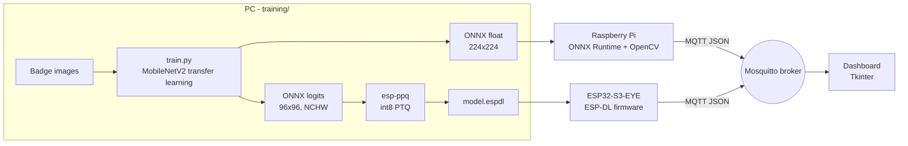

# Embedded Vision-Based Authentication (Raspberry Pi + ESP32-S3)

A camera recognises which access badge pattern it is shown (CEO, CFO, Manager, and so on) with a MobileNetV2 CNN. It then streams the decision and device diagnostics over MQTT to a monitoring dashboard. The same trained pipeline is deployed on two embedded targets:

| | Raspberry Pi | ESP32-S3-EYE |
|---|---|---|
| Language | Python | C++ (ESP-IDF firmware) |
| Runtime | ONNX Runtime (CPU) | ESP-DL v3 (CPU, int8) |
| Model | MobileNetV2 α=1.0, 224×224, float32 | MobileNetV2 α=0.35, 96×96, int8 |
| Conversion | Keras → ONNX (tf2onnx) | Keras → ONNX (tf2onnx) → `.espdl` (esp-ppq PTQ) |
| Camera | USB webcam (OpenCV) | Onboard OV2640 (esp32-camera) |
| Trigger | Continuous or GPIO button | Continuous or BOOT button |



## Repository layout

```
training/            dataset capture, split and augmentation, training, ONNX export
models/pi/           deployed Raspberry Pi model (model.onnx) and class_names.json
models/esp32/        ESP32 training outputs and quantization report (generated)
raspberry_pi/        real-time inference client (runs on a laptop too)
esp32/quantization/  ONNX to int8 .espdl conversion with esp-ppq
esp32/firmware/      ESP-IDF project: camera, ESP-DL inference, Wi-Fi, MQTT
dashboard/           multi-device MQTT dashboard and a device simulator
docs/mqtt.md         topic layout and payload schema
assets/patterns/     the badge patterns used as classes
```

## 1. Train

```bash
cd training
pip install -r requirements.txt          # TensorFlow 2.13, tf2onnx

# Capture images per class (folder name = label), then split 70/20/10 and augment the train split
python capture_dataset.py --class-name CEO --out-dir ../data/raw
python prepare_dataset.py --src ../data/raw --dst ../data/split --augment 5

# Raspberry Pi model (MobileNetV2 1.0 @ 224)
python train.py --target pi
python export_onnx.py --model ../models/pi/model.keras --output ../models/pi/model.onnx

# ESP32 model (MobileNetV2 0.35 @ 96): logits output, NCHW input for esp-ppq
python train.py --target esp32
python export_onnx.py --model ../models/esp32/model.keras --output ../models/esp32/model.onnx --logits --nchw
```

All targets use the same preprocessing: RGB input, full frame resized to the model input, and values scaled to `[0, 1]`.

> The original dataset used the folders `class1` to `class7`, which map in order to the names in `models/pi/class_names.json`. Before retraining, rename the folders to the role names so the generated `class_names.json` is readable.

## 2. Raspberry Pi

```bash
cd raspberry_pi
pip install -r requirements.txt
python inference.py --broker <broker-ip>                              # continuous, every 0.5 s
python inference.py --broker <broker-ip> --trigger button --button-pin 17
```

Run `python inference.py -h` for the thresholds, camera index, thread count and `--show` (live preview). Without `RPi.GPIO` the script still runs in continuous mode, which is handy for testing on a PC.

## 3. ESP32-S3-EYE

### 3a. Quantize to int8 (esp-ppq)

```bash
cd esp32/quantization
pip install torch --index-url https://download.pytorch.org/whl/cpu
pip install -r requirements.txt
python quantize_espdl.py --onnx ../../models/esp32/model.onnx \
                         --class-names ../../models/esp32/class_names.json \
                         --calib-dir ../../data/split/train --eval-dir ../../data/split/test
```

This runs post-training quantization, calibrated on up to 512 training images. ESP-DL uses per-tensor power-of-two scales.

MobileNetV2 is hard to quantize with per-tensor scales. Folded BatchNorm leaves the depthwise layers with channels whose weight ranges differ by orders of magnitude, and plain int8 PTQ collapsed test accuracy from 100% to about 22%. The pipeline fixes this in two steps, following Espressif's MobileNetV2 tutorial:

1. `train.py --target esp32` trains the backbone with ReLU instead of ReLU6.
2. The quantizer applies layerwise weight equalization ([Nagel et al., 2019](https://arxiv.org/abs/1906.04721)).

If accuracy is still too low, `--quant-type w8a16` keeps int8 weights and uses int16 activations.

Measured on the 110-image validation and test splits for the committed ESP32 model (MobileNetV2 0.35, 96×96, 575k parameters, 660 KiB `.espdl`):

| Variant | Accuracy |
|---|---|
| Float (ONNX) | 100% |
| int8, no equalization, ReLU6 | 22% |
| int8 + equalization (default) | 94.5% |
| int8 + equalization, last 6 projection convs in int16 | 95.5% |
| int8 weights, int16 activations (`w8a16`) | 98.2% |

The script produces:

- `esp32/firmware/main/models/model.espdl`, the int8 model with test vectors embedded
- `esp32/firmware/main/class_names.inc`, the label table compiled into the firmware
- `models/esp32/quant_report.json`, which compares float and int8 accuracy on the test split

### 3b. Build and flash (ESP-IDF ≥ 5.3)

```bash
cd esp32/firmware
idf.py set-target esp32s3
idf.py menuconfig        # Vision Auth Configuration → Wi-Fi, MQTT broker URI, device id, trigger, thresholds
idf.py build flash monitor
```

On boot the firmware:

1. Loads the `.espdl` model from flash.
2. Runs `model->test()` against the esp-ppq reference outputs, to catch conversion errors.
3. Starts the camera in QVGA RGB565 mode.
4. Loops: capture a frame, resize, normalize and quantize it with `dl::image::ImagePreprocessor`, run int8 inference, dequantize the logits and apply softmax, then publish the result.

Frame buffers and activations live in the 8 MB PSRAM. The model sits in flash rodata.

Useful settings in `menuconfig`:

- Trigger mode (continuous or BOOT button)
- Delay between inferences
- Unknown and accept thresholds
- Camera flip and mirror

## 4. MQTT broker and dashboard

```bash
# broker (any machine on the LAN), e.g. Mosquitto with anonymous access on 1883
mosquitto -v -c mosquitto.conf

cd dashboard
pip install -r requirements.txt
python dashboard.py --broker <broker-ip>
python simulate_devices.py --broker <broker-ip>    # optional: fake Pi and ESP32 traffic
```

Each device gets its own card showing:

- The identity and whether access is granted
- A confidence bar
- The latency breakdown (preprocessing, inference, total) and FPS
- Diagnostics: heap, PSRAM and RSSI on the ESP32; CPU temperature, load and memory on the Pi
- Online/offline state, driven by retained status messages and the MQTT last will

The payload format is documented in [docs/mqtt.md](docs/mqtt.md).

## Status

- **Raspberry Pi**: the original pipeline was run on a Pi. The refactored client has been checked on a PC with the committed model (101/102 correct on the validation and test splits) and against a local Mosquitto broker.
- **ESP32-S3-EYE**: the firmware builds cleanly with ESP-IDF 5.4.2, esp-dl 3.3.12 and esp32-camera 2.1.8. The app image is 3.3 MB, leaving 45% of the 6 MB partition free. It has not been run on hardware yet. On first run, check:
  - that `model->test()` passes in the serial log;
  - that `quant_report.json` shows int8 accuracy close to float;
  - the colour order. The camera frame is treated as `RGB565BE`; if predictions look colour-swapped, change it in [app_main.cpp](esp32/firmware/main/app_main.cpp).
